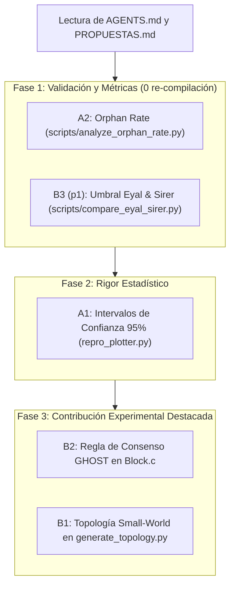

# PROPUESTAS.md — Catálogo Detallado de Mejoras y Extensiones para RBlockSim

Este documento describe a detalle técnico las propuestas de mejora para el simulador **RBlockSim**, organizadas por nivel de novedad y complejidad. Para entender la arquitectura del simulador, cómo compilarlo y el formato de los datos, consultar [AGENTS.md](file:///home/josealva/Projects/parale/RBlockSim_Reproducibility/AGENTS.md).

---

## 1. Perfil de Hardware y Restricciones Operativas

> [!IMPORTANT]
> Todas las propuestas están optimizadas para hardware estándar (**laptop/PC con 8–16 GB de RAM y 4–8 cores**):
> - **Redes objetivo:** 100 y 1,000 nodos (consumo de RAM < 2 GB, ejecución en segundos/minutos).
> - **Datos ya disponibles:** Los experimentos de ataques para redes de 100 y 1,000 nodos ya cuentan con datos en `reproduced/results_attacks_0/` y `reproduced/plots/plots_1/jsons/`.

---

## 2. Tabla Comparativa de Propuestas

| ID | Nombre | Tipo | Toca C | Hardware | Esfuerzo | Impacto Académico |
|---|---|---|---|---|---|---|
| **A1** | Intervalos de Confianza (95% IC) en Figs. 4 y 5 | Completar paper | ❌ Solo Python | < 500 MB | 0.5 día | Media (Rigor estadístico) |
| **A2** | Orphan Rate vs. Referencia Empírica (Bitcoin) | Completar paper | ❌ Solo Python | < 500 MB | 1 día | Media-Alta (Validación externa) |
| **B1** | Topología Small-World vs. Aleatoria | **Más allá del paper** | ❌ Solo Python | < 2 GB | 2 días | **Alta** (Realismo de red) |
| **B2** | Regla de Consenso GHOST | **Más allá del paper** | ✅ Quirúrgico en C | < 2 GB | 3 días | **Muy Alta** (Consenso alternativo) |
| **B3 (p1)** | Umbral Teórico de Eyal & Sirer (Python) | **Más allá del paper** | ❌ Solo Python | < 500 MB | 1 día | **Alta** (Validación teórica) |
| **B3 (p2)** | Desempate con Parámetro $\gamma$ en C | **Más allá del paper** | ✅ Quirúrgico en C | < 2 GB | 2 días | **Alta** (Modelado adversarial fino) |

---

## 3. CATEGORÍA A: Completar Limitaciones del Paper

---

### Propuesta A1 — Intervalos de Confianza en Figuras de Ataques

**Descripción del problema:**
Las Figuras 4 y 5 del paper original muestran curvas promediadas de múltiples iteraciones (`iterations`), pero no grafican la varianza ni barras de error. Para un simulador estocástico con Time Warp, omitir la varianza debilita el rigor estadístico.

**Archivos a modificar:**
- `RBlockSim/scripts/repro_plotter.py`

**Implementación técnica:**
En `repro_plotter.py`, modificar `extract_plot_data_for_average_attacker_committed_percentage` para retornar la media y el intervalo de confianza (IC 95%), y usar `plt.fill_between`:

```python
# Modificación en extract_plot_data_for_average_attacker_committed_percentage:
def extract_plot_data_for_average_attacker_committed_percentage(runs_data):
    hash_to_committed = {}
    for run in runs_data:
        committed_percent = compute_percentage_of_attacker_committed_blocks(run["stats"]["data"])
        hash_power = run["attack_info"]["attacker_hashpower"]
        if hash_power not in hash_to_committed:
            hash_to_committed[hash_power] = []
        hash_to_committed[hash_power].append(committed_percent)

    x, y, y_err = [], [], []
    for h in sorted(hash_to_committed.keys()):
        vals = hash_to_committed[h]
        x.append(h)
        y.append(float(np.mean(vals)))
        # IC 95% usando desviación estándar muestral
        ci = float(np.std(vals, ddof=1) / np.sqrt(len(vals)) * 1.96) if len(vals) > 1 else 0.0
        y_err.append(ci)
    return x, y, y_err

# Modificación en plot_51 y plot_selfish:
def plot_51(size, out_path=None):
    # ...
    for i, r in enumerate(runs_51):
        x, y, y_err = extract_plot_data_for_average_attacker_committed_percentage(r)
        plt.plot(x, y, label=labels[i])
        plt.fill_between(x, np.array(y) - np.array(y_err),
                            np.array(y) + np.array(y_err), alpha=0.15)
    # ...
```

**Ejecución con múltiples iteraciones:**
Editar `reproducibility_config.json`:
```json
{
  "what_to_reproduce": "attacks",
  "network_sizes_attacks": [100, 1000],
  "worker_threads_attacks": 8,
  "iterations": 5
}
```

---

### Propuesta A2 — Orphan Rate como Métrica de Validación

**Descripción del problema:**
El paper valida que la tasa de minado sea proporcional al hash rate (Figura 3), pero nunca reporta la tasa de bloques huérfanos (*orphan rate*). En la literatura (ej. Gervais et al. CCS 2016, ref [11] del paper), se reporta que Bitcoin con intervalo de 600 s tiene un orphan rate de ~0.41%. Todos los datos para calcular esta métrica ya están en los resultados reproducidos.

**Fórmula de cálculo:**
$$\text{Orphan Rate} = \frac{\sum \text{totalBlocksMined} - \text{mainChainHeight}}{\sum \text{totalBlocksMined}}$$

**Archivos nuevos:**
- `RBlockSim/scripts/analyze_orphan_rate.py`

**Implementación del script:**
```python
import json, os, glob
import numpy as np
import matplotlib.pyplot as plt

STATS_MC_HEIGHT = 1
STATS_BLOCKS_MINED_BY_ME = 2

def compute_orphan_rate(stats_data):
    total_mined = sum(node[STATS_BLOCKS_MINED_BY_ME] for node in stats_data)
    mc_height = stats_data[0][STATS_MC_HEIGHT]
    if total_mined == 0:
        return None
    orphans = total_mined - mc_height
    return orphans / total_mined

def analyze_orphan_rates(json_folder, network_sizes):
    results = {}
    for size in network_sizes:
        results[size] = []
        pattern = os.path.join(json_folder, f"{size}_*.json")
        for fpath in glob.glob(pattern):
            with open(fpath) as f:
                runs = json.load(f)
            for run in runs:
                rate = compute_orphan_rate(run["stats"]["data"])
                if rate is not None:
                    results[size].append(rate)
    return results

def plot_orphan_rate(results, out_path):
    sizes = sorted(results.keys())
    means = [np.mean(results[s]) * 100 for s in sizes]
    errs  = [np.std(results[s], ddof=1) / np.sqrt(len(results[s])) * 1.96 * 100 if len(results[s]) > 1 else 0.0 for s in sizes]

    plt.figure()
    plt.errorbar(sizes, means, yerr=errs, marker='o', capsize=5, label='RBlockSim (BI=600s)')
    plt.axhline(y=0.41, color='r', linestyle='--', label='Bitcoin real ~0.41% (Gervais 2016)')
    plt.xscale('log')
    plt.xlabel('Network size (nodes)')
    plt.ylabel('Orphan rate (%)')
    plt.title('Orphan Rate vs Network Size')
    plt.legend()
    plt.savefig(out_path, bbox_inches='tight')
    plt.clf()

if __name__ == "__main__":
    json_folder = "reproduced/plots/plots_1/jsons"
    out_path = "reproduced/plots/plots_1/orphan_rate.eps"
    results = analyze_orphan_rates(json_folder, [100, 1000, 10000])
    plot_orphan_rate(results, out_path)
    for size, rates in results.items():
        print(f"Network {size}: mean orphan rate = {np.mean(rates)*100:.3f}% ± {np.std(rates)*100:.3f}%")
```

---

## 4. CATEGORÍA B: Contribuciones Nuevas (Más Allá del Paper)

---

### Propuesta B1 — Topología Small-World vs. Aleatoria

**Motivación y novedad:**
El paper sólo emplea topologías aleatorias simétricas. Sin embargo, la función `generate_small_world_topology` ya se encuentra implementada en `generate_topology.py` pero nunca es invocada. La red Bitcoin real presenta propiedades de mundo pequeño (bajo diámetro efectivo y alta clusterización).

**Hipótesis:**
Una topología small-world acelerará la propagación de bloques, disminuyendo el orphan rate y reduciendo la tasa de éxito de ataques como selfish mining al acortar los retrasos de propagación.

**Archivos a modificar:**
- `RBlockSim/src/generate_topology.py`
- `RBlockSim/scripts/compare_topologies.py` (nuevo)

**1. Exponer CLI en `generate_topology.py`:**
```python
# Añadir al parser en main():
parser.add_argument("--topology", choices=["random", "small_world"], default="random")
parser.add_argument("--sw_density", type=float, default=0.1)
parser.add_argument("--sw_propagation", type=float, default=0.5)
parser.add_argument("--sw_max_dis", type=int, default=None)

# Modificar lógica de generación:
if args.topology == "small_world":
    max_dis = args.sw_max_dis if args.sw_max_dis else args.n_nodes // 4
    topology = generate_small_world_topology(
        args.n_nodes, args.sw_density, args.sw_propagation, max_dis, args.seed
    )
    max_peers_for_header = max(len(peers) for peers in topology)
    class SmArgs:
        n_nodes = args.n_nodes
        min_peers = 1
        max_peers = max_peers_for_header
    topology_to_c(SmArgs(), topology)
else:
    topology = generate_symmetric_topology(
        args.n_nodes, args.min_peers, args.max_peers, args.seed
    )
    topology_to_c(args, topology)
```

**2. Script de benchmarking comparativo (`scripts/compare_topologies.py`):**
```python
import subprocess, os, json

NETWORK_SIZES = [100, 1000]
RNG_SEEDS = [42, 123, 999, 7777, 12345]

topologies = {
    "random": ["python3", "generate_topology.py", "--topology", "random", "--min_peers", "2", "--max_peers", "6"],
    "small_world": ["python3", "generate_topology.py", "--topology", "small_world", "--sw_density", "0.1", "--sw_propagation", "0.5"],
}

# Flujo: iterar tamaños y topologías, compilar con make rblocksim y evaluar selfish mining con -h 0.3
```

---

### Propuesta B2 — Regla de Selección de Cadena GHOST

**Motivación y novedad:**
El paper menciona explícitamente en la Sección 4.6 que la arquitectura soporta reglas como **GHOST** (*Greedy Heaviest-Observed SubTree*), donde el puntaje evalúa el trabajo acumulado en subárboles (incluyendo uncle blocks). En `Block.h`, los campos `ChainNode.score` y `ChainNode.ancestorsMined` ya están definidos para este propósito.

**Hipótesis:**
Bajo GHOST, los bloques privados de un minero egoísta pierden peso relativo frente a los bloques públicos de mineros honestos que acumulan referencias a bloques hermanos, mitigando la ventaja del ataque selfish mining.

**Archivos a modificar:**
- `RBlockSim/src/Block.c` (en `addBlock`)
- `RBlockSim/Makefile` (añadir target `rblocksim_ghost`)
- `RBlockSim/scripts/compare_fork_rules.py` (nuevo)

**1. Modificación en `Block.c` (~línea 440 en `addBlock`):**
```c
#ifdef USE_GHOST
    // GHOST simplificado: score acumula peso del subárbol
    struct ChainNode *parent_node = getChainNode(chain, new_node->height - 1, new_node->parent_index);
    new_node->score = parent_node->score + 1;
    
    // Contribución de bloques hermanos (uncle blocks) en el nivel anterior
    struct ChainLevel *sibling_level = getChainLevel(chain, new_node->height - 1);
    if (sibling_level->size > 1) {
        new_node->score += (sibling_level->size - 1);
    }
#else
    // Longest-chain estándar: score equivale a la altura
    new_node->score = new_node->height;
#endif
```

**2. Target en `RBlockSim/Makefile`:**
```makefile
rblocksim_ghost: CFLAGS += -DUSE_GHOST
rblocksim_ghost: rblocksim
```

**3. Comparación experimental:**
Ejecutar el ataque selfish en ambas versiones (`rblocksim` vs `rblocksim_ghost`) para $\alpha \in [0.01, 0.99]$. Se espera que la curva de bloques del atacante en la cadena principal sea menor bajo GHOST para $\alpha < 0.5$.

---

### Propuesta B3 — Validación del Umbral Teórico de Eyal & Sirer y Parámetro $\gamma$

**Motivación y novedad:**
Eyal & Sirer (2014) demostraron que el selfish mining es rentable si la potencia del atacante supera el umbral crítico:
$$\alpha > \frac{1 - \gamma}{3 - 2\gamma}$$
Donde $\gamma$ representa la proporción de mineros honestos que escogen la cadena del atacante en caso de empate.
- Si $\gamma = 0$ (el atacante nunca gana desempates): el umbral es $1/3 \approx 0.33$.
- Si $\gamma = 0.5$: el umbral es $0.25$.
- Si $\gamma = 1$: el umbral es $0$.

El paper simula selfish mining pero omite comparar contra estos umbrales teóricos y asume de manera fija $\gamma = 0$ (favoreciendo siempre la cadena previamente vista).

#### Parte 1 — Análisis Teórico en Python (Datos Existentes)
Sin modificar código C, analizar si el punto de cruce en los datos coincide con $\alpha = 1/3$:

**Script `scripts/compare_eyal_sirer.py`:**
```python
import json, os
import numpy as np
import matplotlib.pyplot as plt

STATS_OWN_BLOCKS_IN_MC = 3
STATS_MC_HEIGHT = 1

def eyal_sirer_threshold(gamma):
    return (1.0 - gamma) / (3.0 - 2.0 * gamma)

def plot_with_thresholds(json_folder, network_size, out_path):
    plt.figure()
    for catchup in [1, 2]:
        fname = os.path.join(json_folder, f"{network_size}_selfish_c{catchup}_d2.json")
        with open(fname) as f:
            runs = json.load(f)
        
        alphas, revs = [], []
        for run in runs:
            alpha = run["attack_info"]["attacker_hashpower"]
            aid = run["attack_info"]["attacker_id"]
            stats = run["stats"]["data"]
            mc_h = stats[aid][STATS_MC_HEIGHT]
            own_mc = stats[aid][STATS_OWN_BLOCKS_IN_MC]
            if mc_h > 0:
                alphas.append(alpha)
                revs.append(own_mc / mc_h)
        
        # Promediar por alpha
        unique_alphas = sorted(list(set(alphas)))
        mean_revs = [np.mean([revs[i] for i in range(len(alphas)) if alphas[i] == a]) for a in unique_alphas]
        plt.plot(unique_alphas, mean_revs, label=f'Simulado catchup={catchup}')

    ref = np.linspace(0, 1, 100)
    plt.plot(ref, ref, 'k--', label='Honesto (revenue = α)')
    
    # Umbrales
    for g, col in [(0.0, 'red'), (0.5, 'orange'), (1.0, 'green')]:
        th = eyal_sirer_threshold(g)
        plt.axvline(x=th, color=col, linestyle=':', label=f'Umbral E&S γ={g} (α={th:.2f})')

    plt.xlabel('Attacker Hashpower (α)')
    plt.ylabel('Relative Revenue (Attacker Blocks in MC / Height)')
    plt.title(f'Selfish Mining vs Eyal-Sirer Threshold ({network_size} nodes)')
    plt.legend()
    plt.savefig(out_path, bbox_inches='tight')
    plt.clf()
```

#### Parte 2 — Parametrizar $\gamma$ en C
Hacer configurable la probabilidad de desempate $\gamma$ en `chainNodeMaxHonest()` en [Block.c](file:///home/josealva/Projects/parale/RBlockSim_Reproducibility/RBlockSim/src/Block.c):
En lugar de favorecer determinísticamente el bloque previo en caso de empate, usar un generador pseudoaleatorio con probabilidad $\gamma$ para seleccionar el bloque del atacante.

---

## 5. Plan de Ejecución Sugerido para el Agente



### Comandos de Verificación Inmediata:
```bash
# 1. Probar métrica de orphan rate sobre datos reproducidos:
python3 RBlockSim/scripts/analyze_orphan_rate.py

# 2. Probar umbral de Eyal & Sirer sobre datos reproducidos:
python3 RBlockSim/scripts/compare_eyal_sirer.py

# 3. Probar compilación GHOST:
cd RBlockSim && make rblocksim_ghost
```
